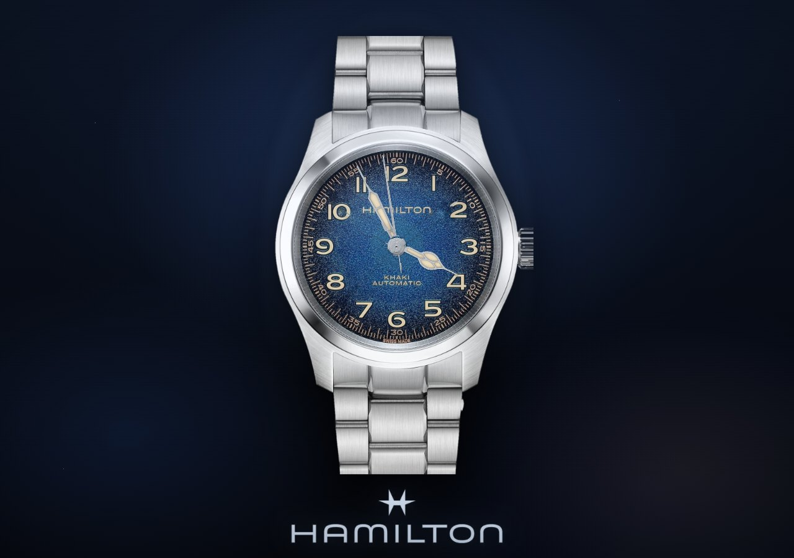
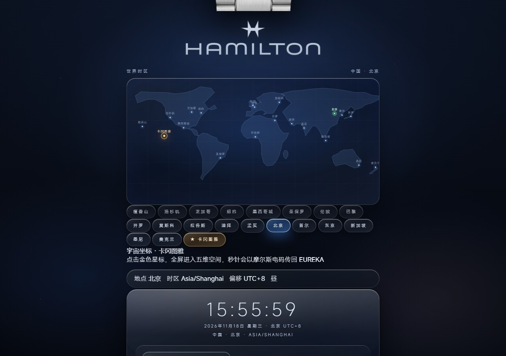
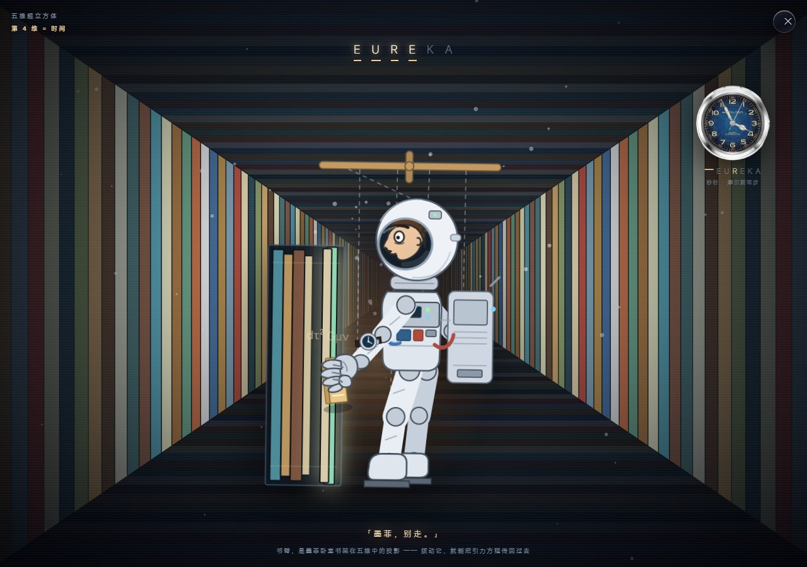
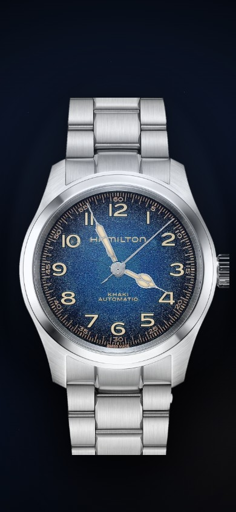

# 汉米尔顿 墨菲 38 · 星尘蓝盘

**一个单文件的「网络对时 + 世界时区 + 星际穿越彩蛋」网页钟。**

深色 HUD 风格，全站中文，界面为 iOS「液态玻璃（Liquid Glass）」质感——半透明磨砂、镜面高光、内阴影，所有方块组件都是胶囊或大圆角。整个页面塞进**一个 HTML**，表盘、指针、图标、logo 全部内嵌 base64，零外部请求、零依赖。

[](https://celinayun.github.io/murph38/)
[](#文件结构)
[](#本地使用)
[](#表盘模式)



## 在线地址

| 入口 | 地址 | 说明 |
|---|---|---|
| 主页 | <https://celinayun.github.io/murph38/> | 完整页面 |
| 表盘模式 | <https://celinayun.github.io/murph38/?face> | 只有表盘，适合添加到主屏幕当桌面图标 |

## 页面展示

### 1 · 世界时区与液态玻璃面板

20 个城市一键切换，当前城市以蓝色玻璃胶囊高亮；地图上的金色星标就是彩蛋入口。



### 2 · 彩蛋：五维超立方体

点击「EUREKA 彩蛋」或地图上的卡冈图雅星标，全屏进入书脊长廊。提线木偶库珀拨动书架、把引力方程传回过去，秒针同时在敲摩尔斯。



### 3 · 表盘模式

`?face` 参数隐藏所有面板，只留全屏表盘，配合「添加到主屏幕」就是点开即表盘的桌面图标。



## 功能

| 模块 | 说明 |
|---|---|
| **国家授时中心对时** | 以 `ntp.ntsc.ac.cn` 为基准，在线复核走 授时中心 → timeapi → worldtimeapi **三级降级**；全部不可达时用构建校准值继续走时，并在状态里明确标注「网络不可达」 |
| **世界时区** | 20 座城市，点击切换；时针/分针用**欠阻尼弹簧**摆到目标角度，秒针全球同步，日期与偏移跟随城市时区 |
| **走时模拟** | 机械 6Hz（H-10 真实步频）/ 石英 1Hz / 平滑扫描，三种秒针运动可选 |
| **夜光模式** | 模拟 Super-LumiNova，把米色时标与夜光条染成荧光绿 |
| **滴答声** | WebAudio 合成，可开关，不加载任何音频文件 |
| **彩蛋** | 全屏五维空间 + 提线木偶 + 摩尔斯电码（详见下节） |
| **表盘模式** | `?face` 极简全屏，适合做主屏图标 |
| **PWA** | manifest + Service Worker，可添加到 iOS / Android 主屏，离线可用 |

## 彩蛋：五维空间

**触发**：点击底部「🎬 EUREKA 彩蛋」，或点地图上那颗金色星标。

**场景构成**

- **书脊长廊**：Canvas 逐帧绘制的各向异性透视——四面墙全是竖排书脊，沿 Z 轴不断向镜头推来，配合雾化与浮尘视差，形成「坠入五维」的穿行感
- **提线木偶库珀**：纯 SVG 手绘，木色控制横杆 + 五根虚线吊绳（盔顶、两腕、两膝），整体带 7 秒周期的轻微摇晃；宇航服用金属轴承环、蓝/红冷却管、PLSS 背包、胸控模块，手是「掌 + 四指 + 拇指」的结构，正捏着一本被抽出的书
- **小手表**：右上角一只真表盘缩略图，蓝盘、米白时标、三根针，与主表**严格同步**
- **字幕**：「墨菲，别走。」

**摩尔斯电码**

秒针不只是走时，它在**敲字母**：

```
E  ·        U  ··—     R  ·—·
E2 ·        K  —·—     A  ·—
```

- 每敲一个「点」偏转 13°，一个「划」偏转 27°，然后由弹簧拉回原位
- 顶部 `E U R E K A` 六个字母随进度依次点亮
- 敲完最后一个字母，落款浮现：**引力方程已送达**
- **右上角小手表的秒针与主表完全一致**——它直接读取主表秒针的角度，连 6Hz 微步进和弹簧回弹都一样（实测两针夹角 0.00°）

任一时刻点击任意位置或右上角 ✕ 即可退出。

## 技术实现

- **单文件 1.05 MB**：所有图片（表盘照片 408 KB、指针图层、Logo、图标）以 base64 内嵌，页面运行时**零网络请求**
- **真实表盘**：表盘与四层指针素材取自官方产品照抠图，指针按盘心旋转角对齐后叠加，不是 CSS 画的
- **液态玻璃**：`backdrop-filter: blur(22px) saturate(180%)` + 多层白色渐变 + `inset 0 1px 0` 镜面高光 + 左上角 `radial-gradient` 光斑；注意 `.panel::before` 必须 `z-index:0` 且内容 `position:relative`，否则高光会盖住文字
- **书墙透视**：`kx = W*0.60*zN`、`ky = H*0.58*zN`，每格画四面（顶/地先铺冷色暗底再上竖纹），`fog = pow(1-t, 1.26)` 做纵深雾化
- **木偶**：全部 SVG 路径，无位图；吊绳用 `stroke-dasharray` 画虚线

## 文件结构

```
├── index.html                        # GitHub Pages 入口（= deploy 版）
├── hamilton-murph-38-blue-steel.html # 主交付物（单文件，可直接双击打开）
├── hamilton-murph-38-ios.html        # iOS / PWA 版（追加 apple meta 与启动图）
├── manifest.webmanifest              # PWA 清单
├── dial.webp                         # 透明底表盘图（640px），供 Scriptable 小组件使用
├── murph38-scriptable-widget.js      # iOS 桌面小组件脚本（Scriptable）
├── docs/screens/                     # README 展示截图
├── deploy/
│   ├── murph38-ios-pwa.zip           # 静态托管部署包（含 _headers）
│   └── murph38/                      # 部署目录（index.html + manifest + 表盘图）
└── scripts/
    ├── build_ios.py                  # 由主文件生成 iOS/PWA 版
    └── build_deploy.py               # 生成部署目录与 zip
```

## 本地使用

直接双击 `hamilton-murph-38-blue-steel.html` 即可，**不需要构建、不需要起服务器**。

构建（可选，需要 Python）：

```bash
python scripts/build_ios.py      # 生成 hamilton-murph-38-ios.html 与 manifest
python scripts/build_deploy.py   # 生成 deploy/murph38/ 与部署 zip
```

## 声明

- 粉丝致敬作品，与 Hamilton Watch、派拉蒙影业、传奇影业均无关联
- 表盘照片仅用于个人非商业展示
- 页面文案全部为中文；保留的非中文项均为标识符：`EUREKA`（摩尔斯电码内容）、`Asia/Shanghai`、`UTC+8`、`ntp.ntsc.ac.cn`、`6Hz / 1Hz`、`H-10`
